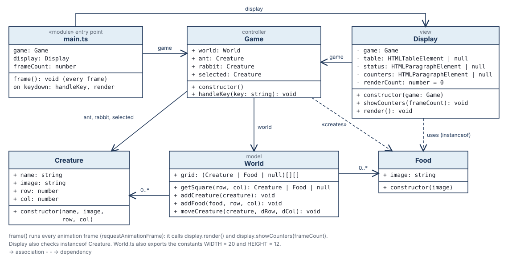

# Artificial Life

A 20 x 12 grid with an ant, a rabbit and some food - a starting point for exploring design patterns.
See `TDDs/` for what each version should do.

## Version 1

- a 20 wide by 12 high grid; each square is empty, or has a creature or food (🥕) in it
- two creatures: 
    - the ant: 🐜
    - the rabbit: 🐇
- **1** / **2** selects the ant / rabbit; the **arrow keys** move it one step
- a creature can't move off the grid or into another creature; moving onto food eats it

The code is deliberately simple - there is plenty of room to improve it with design patterns.

## Running it

Open the project in Celbridge. The console at the bottom starts by itself, and runs `deno task dev`:

1. **builds** `src/` (TypeScript) and `public/` (HTML, CSS, images) into `dist/`
2. **tests** everything in `tests/`, printing the results in the console (in TAP format) and writing a
   readable report to `test_output/index.html` (and `test_output/summary.md`)
3. **watches** - every time you save a file in `src/`, `public/` or `tests/`, it does it all again

`dist/index.html` opens beside the console. After a rebuild, its preview's **refresh** button lights
up - press it to see your changes. The clipboard icon opens the test report.

The console's buttons: rebuild-and-watch, build once, test once, and lint. To use them while the
watcher is running, press **Ctrl+C** first to stop it.

No server is needed: `dist/` is a plain web page, so you can also open `dist/index.html` in any browser.

## Class diagram (version 1)

The code follows **MVC**: `World` is the model, `main.ts` is the view, and `Game` is the controller.

## The files

### Classes (`src/`)

- `src/Creature.ts` - **Creature**: a creature on the grid (the ant or the rabbit). Holds its name, its
  picture, and its row and column.
- `src/Food.ts` - **Food**: something a creature can eat. Holds just its picture.
- `src/World.ts` - **World** (the **model**): the 20 x 12 grid. Each square is `null` (empty), a `Creature`
  or a `Food`. It has the rules for moving: a creature can't leave the grid or walk into another
  creature, and it eats any food it moves onto. Also exports the `WIDTH` and `HEIGHT` constants.
- `src/Game.ts` - **Game** (the **controller**): creates the world, the ant, the rabbit and the food, and
  remembers which creature is selected. `handleKey()` turns a key press into a change to the world.
- `src/main.ts` - the **view**, and the entry point (not a class). The only file that touches the web
  page: it rebuilds the HTML table from the grid after every key press.

### Tests (`tests/`)

- `tests/World.test.ts` - tests for the grid and the movement rules
- `tests/Game.test.ts` - tests for the player controls (selecting and moving creatures)

### The web page (`public/`, copied into `dist/` by the build)

- `public/index.html` - the page: a heading, the instructions, and the empty `<table>` that `main.ts` fills
- `public/css/styles.css` - the look; the grid's styles are at the bottom, under "this project"
- `public/images/sprites/` - the PNG pictures for the creatures and food

### Everything else

- `TDDs/` - the technical design docs: what each version should do
- `README_images/` - pictures used in this README
- `build.ts` - builds `src/` and `public/` into `dist/`, then runs the tests (you never need to edit it)
- `deno.json` - the `deno task` commands (`dev`, `build`, `test`, `check`, `lint`) and settings
- `terminal.console` - the Celbridge console, and its buttons
- `artificial_life.celbridge` - the Celbridge project file (which files open when the project loads)
- `tools/test_report.ts` - runs the tests and writes the report in `test_output/`
- `tools/emoji-sprite/`, `tools/image-editor/`, `tools/sound-fx/` - Celbridge tools for making sprites,
  editing images, and making sound effects
- `dist/`, `test_output/` - made by the build; don't edit these, they are rebuilt on every save
