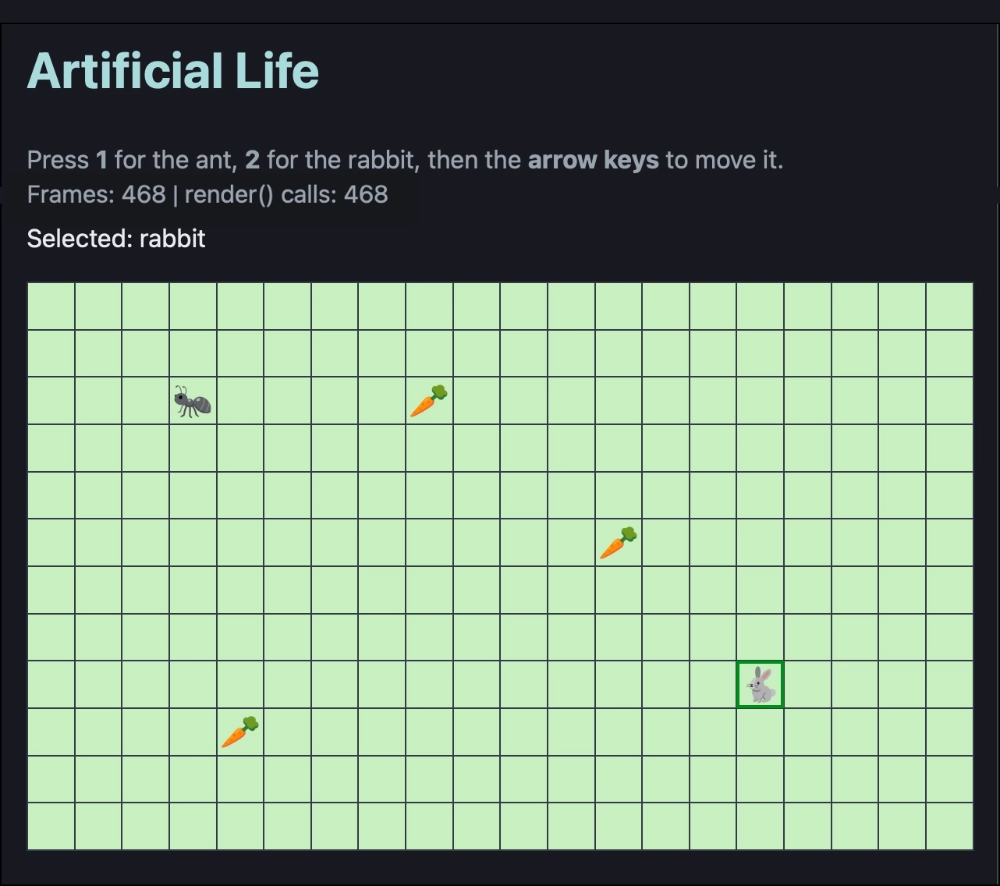

# Artificial Life - `ex2-separate-model-view-controller/`

A 20 x 12 grid with an ant, a rabbit and some food - a starting point for exploring design patterns
(MVC, observer / pub-sub, state, ...).

This folder is one of the Artificial Life projects - **a solution to exercise 2**. The [main README](../README.md) lists them
all, and the exercises are in [`../exercises/`](../exercises/).



## This project: `ex2-separate-model-view-controller/` - a solution to exercise 2

- a 20 wide by 12 high grid; each square is empty, or has a creature or food (🥕) in it
- two creatures: 
    - the ant: 🐜
    - the rabbit: 🐇
- **1** / **2** selects the ant / rabbit; the **arrow keys** move it one step
- a creature can't move off the grid or into another creature; moving onto food eats it
- a simple **game loop**: `main.ts` redraws the grid on every animation frame (about 60 a second), using
  `requestAnimationFrame`
- two **counters** above the grid: how many frames have been drawn, and how many times `render()` has been
  called. They climb together, because the grid is redrawn every frame whether or not anything changed
  (that is exercise 3)

The code is deliberately simple - there is plenty of room to improve it with design patterns.

## Running it

From a terminal in this folder (`ex2-separate-model-view-controller/`):

```bash
deno task dev
```

1. **builds** `src/` (TypeScript) and `public/` (HTML, CSS, images) into `dist/`
2. **tests** everything in `tests/`, printing the results in the terminal (in TAP format) and writing a
   readable report to `test_output/index.html` (and `test_output/summary.md`)
3. **watches** - every time you save a file in `src/`, `public/` or `tests/`, it does it all again. Only
   one build runs at a time: saving during a build just means one more build once it has finished

Open `dist/index.html` in a browser - no server is needed, `dist/` is a plain web page - and refresh it after
each rebuild. Press **Ctrl+C** to stop watching.

The other tasks: `deno task build` (build and test, once), `deno task test` (test, once) and `deno task lint`
(look for likely mistakes and bad habits).

In Celbridge, the console's buttons run these for each project - see the [main README](../README.md).

## Class diagram


The code follows **MVC**: `World` is the model, `Display` is the view, and `Game` is the controller.
`main.ts` is not a class: it creates the game and its display, passes key presses to the game, and runs the
game loop.

## The files

### Classes (`src/`)

- `src/Creature.ts` - **Creature**: a creature on the grid (the ant or the rabbit). Holds its name, its
  picture, and its row and column.
- `src/Food.ts` - **Food**: something a creature can eat. Holds just its picture.
- `src/World.ts` - **World** (the **model**): the 20 x 12 grid. Each square is `null` (empty), a `Creature`
  or a `Food`. It has the rules for moving: a creature can't leave the grid or walk into another
  creature, and it eats any food it moves onto. Also exports the `WIDTH` and `HEIGHT` constants.
- `src/Game.ts` - **Game** (the **controller**): creates the world, the ant, the rabbit and the food, and
  remembers which creature is selected. `handleKey()` turns a key press into a change to the world.
- `src/Display.ts` - **Display** (the **view**): the only class that touches the web page. `render()`
  rebuilds the HTML table from the grid (and counts how often it is called); `showCounters()` shows the
  frame and `render()` counts.
- `src/main.ts` - the entry point (not a class). Creates the `Game` and the `Display`, passes each key
  press to `game.handleKey()`, and runs the game loop: every frame, `frame()` calls `display.render()`
  and `display.showCounters()`.

### Tests (`tests/`)

- `tests/World.test.ts` - tests for the grid and the movement rules
- `tests/Game.test.ts` - tests for the player controls (selecting and moving creatures)

### The web page (`public/`, copied into `dist/` by the build)

- `public/index.html` - the page: a heading, the instructions, the status and counters lines, and the
  empty `<table>` that `Display` fills
- `public/css/styles.css` - the look; the grid's styles are at the bottom, under "this project"
- `public/images/sprites/` - the PNG pictures for the creatures and food

### Everything else

- `README_images/` - pictures used in this README
- `build.ts` - builds `src/` and `public/` into `dist/`, then runs the tests; with `--watch` it rebuilds on
  every save (you never need to edit it)
- `deno.json` - the `deno task` commands (`dev`, `build`, `test`, `check`, `lint`) and settings
- `deno.lock` - the exact versions of the libraries the tests use
- `tools/test_report.ts` - runs the tests and writes the report in `test_output/`
- `dist/`, `test_output/` - made by the build; don't edit these, they are rebuilt on every save
